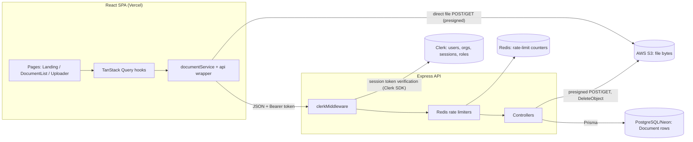

# Architecture

How DocVault's pieces fit together. Read this first, then [DATAFLOW.md](DATAFLOW.md) for the step-by-step request flows.

## The big idea

DocVault is a **multi-tenant document vault**. The important design decisions:

1. **The tenant is a Clerk Organization.** There is no `Organization` or `User` table in the database. Clerk owns identity and membership; the app only stores Clerk's `orgId` and `userId` strings on each `Document` row. Every request is authorized against the caller's active `orgId` - the exact lookup-then-authorize pattern per endpoint is spelled out in "Tenant isolation" below.
2. **Files never pass through the backend.** The server issues short-lived presigned URLs and the browser uploads to / downloads from S3 directly. The backend stays cheap and stateless; S3 does the heavy lifting.
3. **Two stores, one source of truth each.** S3 holds the bytes; Postgres holds the metadata (`Document` rows). They are kept in sync by the frontend calling two endpoints in sequence, not by a transaction - see "Known weaknesses".
4. **Rate limiting lives at the edge of expensive operations.** Presign endpoints (which authorize S3 work) are throttled per user and per org in Redis.

## System diagram

Note on the diagram's Clerk arrow: the only Clerk interaction shown is `clerkMiddleware` verifying the session token. The `getAuth(req)` calls in controllers just read the auth context the middleware already attached to the request (`userId`, `orgId`, `has(role)`) - they are local reads, not per-request network calls from the controller to Clerk.

## Backend (Express 5, `backend/`)

`server.js` wires everything in order: CORS (allowlist of the Vercel URL + localhost:5173) -> JSON parsing -> `clerkMiddleware()` on every request -> two routers.

`clerkMiddleware` does not block anything by itself. It verifies the session token and attaches auth state; each controller then calls `getAuth(req)` and decides:

- no `userId` -> **401**
- no `orgId` (user hasn't selected an organization) -> **403**

### The two routers

| Router | File | Job |
| --- | --- | --- |
| `/api/S3FileAccess` | `routes/S3FileAccessRoutes.js` | Issue presigned upload/download URLs and delete S3 objects. The presign routes are wrapped in rate limiters. |
| `/api/documents` | `routes/DocumentRoutes.js` | CRUD for the metadata rows in Postgres. |

This split mirrors the two stores: one controller talks to AWS, the other talks to Prisma. `deleteS3File` is the exception - it reads Postgres too, because it needs the row's `uploaderId` for the permission check.

### Tenant isolation is enforced three ways

1. **Database:** listing is filtered directly (`findMany({ where: { orgId } })`), and `schema.prisma` indexes `orgId` so tenant queries stay fast. The two delete paths look rows up differently - `deleteDocument` does `findUnique({ id })` and `deleteS3File` does `findFirst({ s3Key })`, neither filtered by org - and then enforce tenancy as a separate authorization check (`document.orgId !== auth.orgId` -> 403, or the S3 key prefix check) before deleting.
2. **S3 keys:** uploads are forced into `organizations/<orgId>/<uuid>-<filename>`. Download and delete re-check that the requested key starts with the caller's own org prefix, so a user cannot guess another tenant's key.
3. **Cross-check on save:** `saveDocument` rejects a record whose `s3Key` doesn't match the caller's org prefix, so the DB can't point at another tenant's object.

### Role checks (RBAC)

Delete is the only restricted action: the caller must be the original uploader or have the Clerk role `org:admin` (`auth.has({ role: "org:admin" })`). Listing, uploading and downloading are open to every org member.

### Rate limiting (`middlewares/rateLimiter.js`)

Four limiters share one Redis connection, each with its own key prefix:

| Limiter | Key | Limit |
| --- | --- | --- |
| `userUploadLimiter` | per user **per org** | 20 / hour |
| `orgUploadLimiter` | per org | 500 / hour |
| `userDownloadLimiter` | per user per org | 50 / hour |
| `orgDownloadLimiter` | per org | 250 / hour |

Key builders live in `helpers/userKeyGenerartor.js` (yes, the filename is misspelled - renaming it means updating the import in `rateLimiter.js`). Per-user-per-org keys mean Alice's quota in Org A doesn't burn her quota in Org B. The org-wide buckets protect AWS costs if one org goes wild. Note that Redis is a hard dependency: `config/redisClient.js` throws at startup without `REDIS_URL`.

### Database access (`config/db.js`)

A `pg.Pool` feeds Prisma 7's driver adapter (`@prisma/adapter-pg`). The generated client lands in `backend/generated/prisma` (that's why `postinstall` runs `prisma generate`). `connectDB()` runs `SELECT 1` at boot and kills the process if the database is down.

## Frontend (React 19 + Vite, `frontend/`)

Provider stack in `main.jsx`, outside-in:

`QueryClientProvider` -> `BrowserRouter` (+ `ScrollToTop`) -> `ErrorBoundary` -> `ClerkProvider` -> `App`

Routes (`App.jsx`): `/` is a public landing page; `/documents` and `/upload` sit behind `ProtectedRoute`, which waits for Clerk to finish loading (`isLoaded`) before redirecting signed-out users home. After sign-in/up Clerk redirects to `/documents`.

### The data layer, in three pieces

1. **`utils/api.js`** - one fetch wrapper. Adds the base URL and the Clerk session token as a Bearer header, parses JSON, and turns HTTP errors into thrown `Error`s with the server's message.
2. **`services/documentService.js`** - one function per backend endpoint, plus `uploadToS3` which deliberately bypasses the wrapper (S3 wants multipart form data, not JSON).
3. **`hooks/`** - TanStack Query hooks the pages actually use:
   - `useDocuments` - cached list. The query key is `["documents", orgId]`, so each org's list is cached separately and switching organizations triggers a fresh fetch rather than rendering the previous org's cached rows. (This describes the cache behavior in the code, not a hardened security boundary - the backend's org filters are the actual enforcement.)
   - `useDocumentUpload` - the 3-step upload mutation; invalidates the list on success.
   - `useDocumentDownload` - gets the presigned URL, fetches the blob itself (so AWS XML errors surface properly), and triggers a browser download via a temporary object URL.
   - `useDocumentDelete` - calls S3 delete, then DB delete; invalidates the list.

The pages (`DocumentList`, `Uploader`) stay thin: all server knowledge lives in the hooks and the service.

### UI-side permission check

`DocumentList` hides the delete button unless you uploaded the file or have `org:admin` or `org:owner`. This is cosmetic - the backend re-checks anyway. Mismatch to know about: the backend only accepts the uploader or `org:admin`, so an `org:owner` (if you use that custom role) sees a button the API will reject with 403.

## Request authentication end to end

1. Clerk React holds the session; hooks call `getToken()` before every request.
2. The token goes out as `Authorization: Bearer <token>`.
3. `clerkMiddleware()` verifies it on every request.
4. Controllers read `userId` / `orgId` / roles from `getAuth(req)` - never from the request body. That's why the frontend can't impersonate another org by editing a payload.

## Known weaknesses (understanding aids, not new bugs)

- **Two-call delete is not atomic.** `useDocumentDelete` deletes from S3 first, then Postgres. If the second call fails, the row points at a missing object. The reverse order would leave an orphaned S3 object instead. A real fix is a background reconciler or a single backend endpoint that does both.
- **List has no pagination or search** - fine at demo scale, painful at thousands of rows. `todo.md` tracks both.
- **Rate limits cover presigning only.** List and delete are unthrottled.
- **Presigned URLs are bearer tokens.** For their 2-minute life, anyone holding the URL can use it. That's the standard trade-off of the pattern; the short expiry is the mitigation.
- **No tests.** `npm test` in the backend is the placeholder that exits 1.
