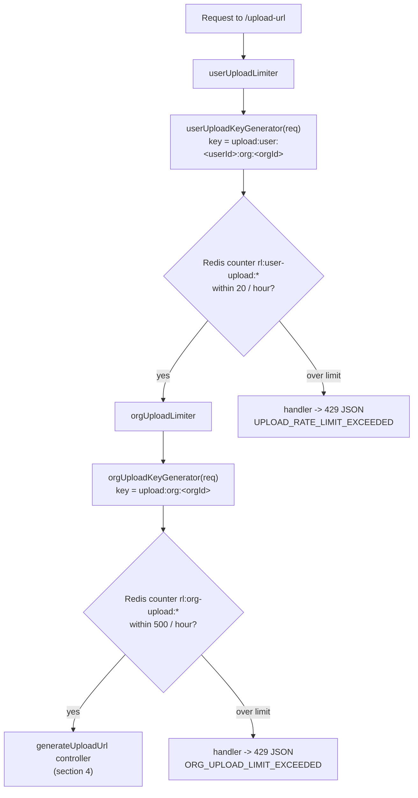

# Code walkthrough: how a request actually executes

This is the "follow the execution" companion to [ARCHITECTURE.md](ARCHITECTURE.md) and [DATAFLOW.md](DATAFLOW.md). Those show the shape of the system; this one traces which function runs, in what order, what it checks, what it calls next, and what it returns - for every endpoint, plus the frontend side. Written against commit `203acd9`.

## 1. The cast: what kind of thing each file is

| File | Role | Exports |
| --- | --- | --- |
| `backend/src/server.js` | Entry point. Builds the Express app, mounts middleware and routers, starts listening. | nothing (side effects) |
| `backend/src/config/db.js` | Creates the Prisma client over a `pg.Pool`. | `prisma`, `connectDB()`, `disconnectDB()` |
| `backend/src/config/redisClient.js` | Creates and connects the Redis client at import time. Throws if `REDIS_URL` is missing. | `redis` |
| `backend/src/config/s3ClientInstance.js` | Creates one AWS S3 client from env credentials. | default `s3ClientInstance` |
| `backend/src/middlewares/rateLimiter.js` | Builds four `express-rate-limit` middlewares backed by Redis. | `userUploadLimiter`, `orgUploadLimiter`, `userDownloadLimiter`, `orgDownloadLimiter` |
| `backend/src/helpers/userKeyGenerartor.js` | Key builders that decide *whose* counter a request increments. | 4 key-generator functions |
| `backend/src/helpers/rateLimiterHandler.js` | Factory that builds the 429 response function. | `createRateLimitHandler(code, message)` |
| `backend/src/routes/*.js` | Routers: map method+path to a chain of middleware ending in a controller. | one Express `Router` each |
| `backend/src/controllers/*.js` | The actual handlers. Read auth, validate input, call Prisma/AWS, send the response. | one function per endpoint |

## 2. Every request: the gauntlet in `server.js`

`server.js` runs top to bottom once at boot. After that, **every** incoming request passes through this chain in this exact order:

```
request
  -> cors(...)                 # rejects browser calls from origins not in the allowlist
  -> express.json()            # parses JSON bodies into req.body
  -> express.urlencoded()      # parses form bodies
  -> clerkMiddleware()         # verifies the Bearer token, attaches auth context to the request
  -> /api/S3FileAccess router  # if the path matches
  -> /api/documents router     # if the path matches
  -> GET /protected, GET /     # the two loose test routes
```

Key detail: `clerkMiddleware()` itself never rejects anyone. It only *attaches* the verified auth state. Rejection happens later, inside each controller, via `getAuth(req)` - which is why every controller starts with the same two checks.

Boot sequence, also in `server.js`: `connectDB()` runs `SELECT 1` and kills the process if Postgres is down; `config/redisClient.js` connects at import time, before the server file even finishes loading; the process handlers at the bottom (`unhandledRejection`, `uncaughtException`, `SIGTERM`) close the server and disconnect Prisma on the way out.

## 3. The rate-limit pipeline (applies to presign endpoints only)

Take `POST /api/S3FileAccess/upload-url`. The router line is:

```js
router.post("/upload-url", userUploadLimiter, orgUploadLimiter, generateUploadUrl);
```

Express runs them left to right. The first two are middleware: they either call `next()` (request continues) or send a 429 and end it there.



How the pieces call each other:

1. `userUploadLimiter` was built by `rateLimit({...})` in `middlewares/rateLimiter.js`. On each request it calls its `keyGenerator` - `userUploadKeyGenerator(req)` from `helpers/userKeyGenerartor.js` - which calls `getAuth(req)` and returns the string `upload:user:<userId>:org:<orgId>` (or throws, because rate limiting a request with no user/org makes no sense).
2. The limiter increments that key in Redis through its `RedisStore` (prefix `rl:user-upload:`, so the full Redis key is `rl:user-upload:upload:user:<userId>:org:<orgId>`). All four limiters share one Redis connection but use different prefixes, so their counters never collide.
3. Over the limit? The limiter calls its `handler`, built by `createRateLimitHandler(code, message)` in `helpers/rateLimiterHandler.js`. That factory returns a `(req, res)` function that sends `429` with `{status: "error", code, message}`. Under the limit? `next()`.
4. Then `orgUploadLimiter` repeats the same dance with the org-wide key and its 500/hour budget.

The download endpoint is identical with its own pair (`userDownloadLimiter` 50/hr, `orgDownloadLimiter` 250/hr). **Nothing else is rate limited** - list, save, and both delete legs go straight to their controllers.

## 4. Endpoint-by-endpoint execution traces

Each trace lists: checks in order (with the exact failure response), the external calls made, and what a success returns.

### POST `/api/S3FileAccess/upload-url` -> `generateUploadUrl`

1. `getAuth(req)` -> `!userId`: **401** `"You must be logged in to upload files."` -> `!orgId`: **403** `"You must select an Organization first."`
2. Body check: missing `filename` or `contentType`: **400**.
3. Builds the S3 key: `organizations/<orgId>/<uuidv4()>-<filename>`. The org comes from the verified token, so a client cannot nominate another tenant's folder.
4. Calls AWS: `createPresignedPost(s3ClientInstance, {Bucket, Key, Conditions, Fields, Expires})`. Conditions enforce max 10 MB (`content-length-range` 0..10485760) and the declared content type; the ticket dies after 120 seconds.
5. Returns **200** `{url, fields, s3Key}`. `url`+`fields` are the upload ticket the browser posts to S3; `s3Key` is what the browser must hand back in step 3 of the upload flow.

### POST `/api/documents` -> `saveDocument`

1. Same auth gates: **401** no user, **403** no org.
2. Body check: `name`, `s3Key`, `size`, `mimeType` all required: **400**.
3. Cross-tenant check: `s3Key` must start with `organizations/<auth.orgId>/`, else **403** "File key does not match your active organization." This stops the DB from registering a row pointing at another org's object.
4. Calls `prisma.document.create({data: {...orgId, uploaderId}})` - this is where the metadata row lands in Postgres.
5. Returns **201** `{message, document}` (the full created row). The frontend's `useDocumentUpload` resolves its mutation with this and invalidates the list cache.

### GET `/api/documents` -> `listDocuments`

1. Auth gates: **401** / **403**.
2. `prisma.document.findMany({where: {orgId}, orderBy: {createdAt: "desc"}})` - the only query in the app that filters by org *inside* the database call, backed by the `@@index([orgId])`.
3. Returns **200** `{status: "success", data: [...]}`. The hook unwraps `.data` and caches it under `["documents", orgId]`.

### POST `/api/S3FileAccess/download-url` -> `generateDownloadUrl`

1. Auth gates: **401** / **403**. (Note: the 401 message here also says "upload files" - copy-paste slip, harmless.)
2. Body check: `s3Key` required: **400**.
3. Prefix check: key must start with the caller's org folder, else **403** "cannot access files outside your workspace". This is what makes a guessed key useless.
4. Builds a `GetObjectCommand` and calls `getSignedUrl(s3ClientInstance, command, {expiresIn: 120})`.
5. Returns **200** `{downloadUrl}`. The frontend then fetches that URL itself (see section 6).

### POST `/api/S3FileAccess/delete-file` -> `deleteS3File`

1. Auth gates: **401** / **403**.
2. Body check: `s3Key` required: **400**. Prefix check: **403**.
3. `prisma.document.findFirst({where: {s3Key}})` - **not** org-filtered; it fetches the row to learn who uploaded it. Missing row: **404**.
4. RBAC: `isUploader = document.uploaderId == auth.userId`, `isAdmin = auth.has({role: "org:admin"})`. Neither: **403** "only uploader or admin can delete this record". This is the lookup-then-authorize pattern: the lookup is by key, the org/role enforcement is a separate check afterwards.
5. Calls AWS: `s3ClientInstance.send(new DeleteObjectCommand({Bucket, Key}))`.
6. Returns **200** `"File securely removed from AWS S3."`

### DELETE `/api/documents/:id` -> `deleteDocument`

1. Auth gates: **401** / **403**.
2. `prisma.document.findUnique({where: {id: req.params.id}})` - again not org-filtered. Missing: **404**.
3. Org check: `document.orgId !== auth.orgId` -> **403** "Access Denied."
4. Same RBAC as above: uploader or `org:admin`, else **403**.
5. `prisma.document.delete({where: {id}})`.
6. Returns **200** `"Database record deleted successfully."`

Remember: the frontend always calls delete-file *then* DELETE by id (section 6), so a full delete is this trace and the previous one back to back, with the RBAC check run twice.

### GET `/protected` (test route)

Calls `getAuth(req)` and returns **401** if `!auth.isAuthenticated`, otherwise dumps the whole auth object as JSON. Handy for debugging what Clerk attached.

## 5. The config modules (imported once, used everywhere)

- **`config/db.js`**: `new pg.Pool({connectionString: DATABASE_URL})` -> wrapped in `new PrismaPg(pool)` -> passed as `adapter` to `new PrismaClient({adapter, log})`. In development it logs every query; in production only errors. `connectDB()` runs `` prisma.$queryRaw`SELECT 1` `` as a wake-up ping (Neon databases sleep). `disconnectDB()` is what the shutdown handlers in `server.js` await.
- **`config/redisClient.js`**: throws at import if `REDIS_URL` is unset, connects immediately with top-level `await`, logs errors without crashing. Because the rate limiter imports it, Redis is effectively a boot dependency.
- **`config/s3ClientInstance.js`**: one shared `S3Client` built from `AWS_REGION` + the IAM key pair. Both presign functions and the delete use this same instance.

## 6. The frontend half of the execution

### The one fetch wrapper: `utils/api.js`

Every backend call (except the direct S3 upload) goes through `api(endpoint, options)`:

1. Builds the URL from `VITE_API_BASE_URL` + endpoint.
2. Pulls `token` out of the options and sets `Authorization: Bearer <token>` - hooks get that token from Clerk's `useAuth().getToken()`.
3. On response: 204 -> return `null`; non-JSON content-type -> throw a "server returned an invalid response" error; parse JSON; `!response.ok` -> throw with the server's `error`/`message` field (this is how a 403 "Access Denied" becomes a readable toast).
4. Network failure (`fetch` itself throws) -> rethrown as "Cannot connect to server...".

### `services/documentService.js`

Pure plumbing - one function per backend endpoint, each delegating to `api()`. The exception is `uploadToS3(url, fields, file)`, which skips the wrapper on purpose: it builds `FormData` from the presigned `fields`, appends the file last (S3 requires `file` to be the final field), and POSTs straight to the AWS `url`. Anything not OK -> throws "AWS S3 rejected the file".

### The hooks (what pages actually call)

- **`useDocuments()`** - `useQuery` with key `["documents", orgId]`. `queryFn` grabs a token, calls `documentService.getDocuments(token)`, returns `response.data`. `enabled: isLoaded && !!orgId` means it won't fire until Clerk knows who you are and an org is selected. `staleTime: 10 min`.
- **`useDocumentUpload()`** - a `useMutation` whose `mutationFn` chains the three service calls in order: `getUploadTicket` -> `uploadToS3` -> `saveDocumentRecord`, returning the saved document. `onSuccess` invalidates `["documents"]` so the list refetches.
- **`useDocumentDownload()`** - mutation that calls `downloadDocument` for the presigned URL, then `fetch`es it, checks for AWS's XML error responses, converts to a `Blob`, makes a temporary `window.URL.createObjectURL`, clicks a hidden `<a download>`, and revokes the URL. Toasts on success/failure.
- **`useDocumentDelete()`** - mutation that calls `deleteFromS3(s3Key)` **then** `deleteFromDatabase(id)`, in that order, then invalidates the list.

### Route guarding and page states

- `ProtectedRoute` (`utils/ProtectedRoutes.jsx`): `useUser()` -> if `!isLoaded`, render "Verifying session..."; if `!isSignedIn`, `<Navigate to="/">`; otherwise render the child route via `<Outlet/>`. `/documents` and `/upload` sit inside it in `App.jsx`.
- `DocumentList` renders five mutually exclusive states in this order: no org selected -> loading -> error -> empty -> the table. The delete button only renders when `doc.uploaderId === userId || has({role:"org:admin"}) || has({role:"org:owner"})` (cosmetic; the backend re-checks and would reject `org:owner`).
- `Uploader` keeps the selected file in local state, calls `uploadMutation.mutate(file)`, and navigates to `/documents` on success.

## 7. Quick reference: where each check lives

| Check | File / function | Fails with |
| --- | --- | --- |
| Signed in (`userId`) | every controller, via `getAuth(req)` | 401 |
| Org selected (`orgId`) | every controller | 403 |
| Rate limits | `middlewares/rateLimiter.js` + key builders | 429 JSON with a `code` |
| Required body fields | top of each controller | 400 |
| S3 key inside caller's org | prefix check in save/download/delete | 403 |
| Record exists | `findUnique`/`findFirst` in delete paths | 404 |
| Record belongs to caller's org | `document.orgId !== auth.orgId` in `deleteDocument` | 403 |
| Uploader or `org:admin` | both delete legs, `auth.has({role})` | 403 |
| Route requires login | `ProtectedRoute` (frontend) | redirect to `/` |
| File size / type / ticket age | AWS, enforced via presigned POST conditions | S3 rejects the POST |
