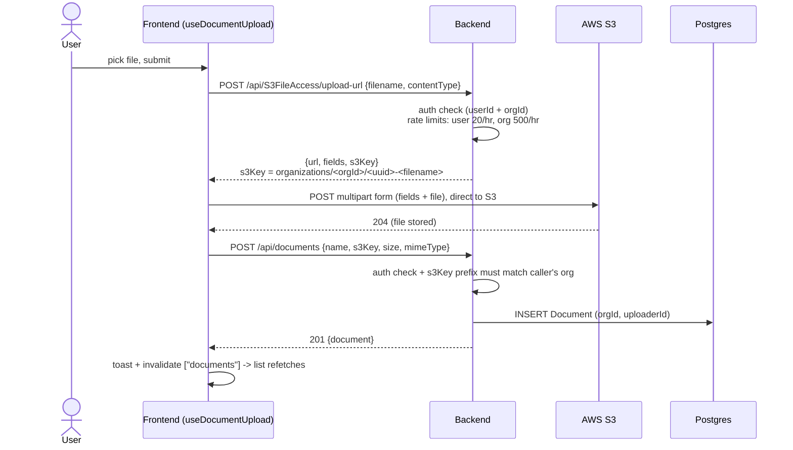
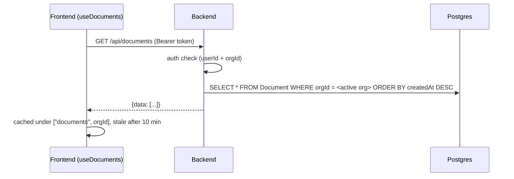
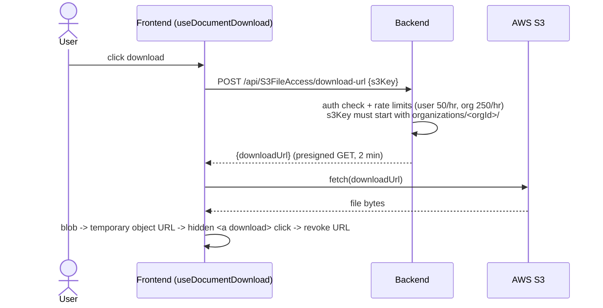
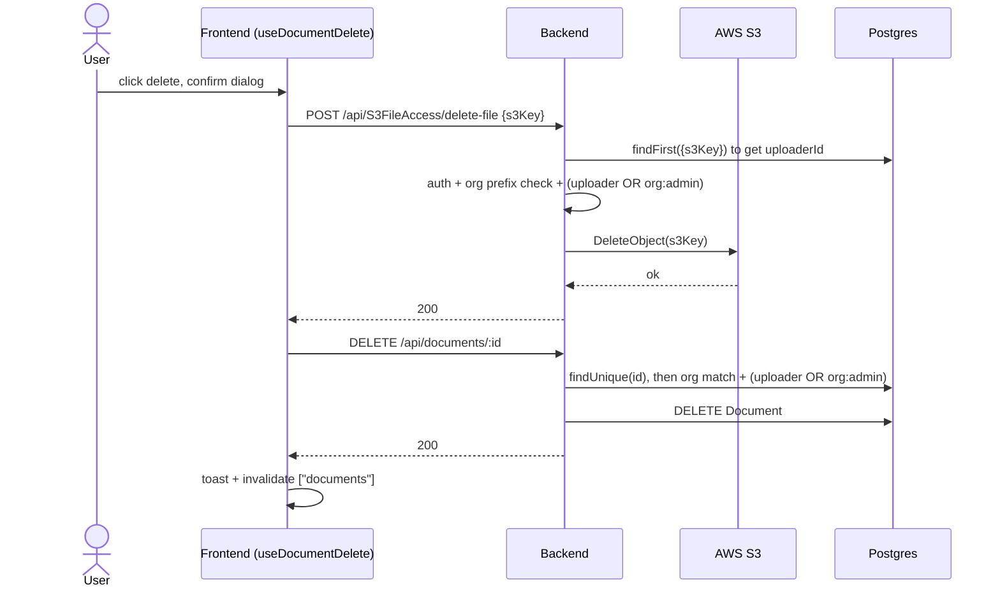

# Data flow

What actually happens, request by request, when someone uses DocVault. Pair with [ARCHITECTURE.md](ARCHITECTURE.md).

## 0. Signing in and picking a tenant

1. The user signs in through Clerk (`AuthGroup` in the navbar). `ClerkProvider` then redirects them to `/documents`.
2. The user picks an organization with Clerk's `OrganizationSwitcher`. From this point, Clerk's session carries an active `orgId` - that **is** the tenant.
3. Every API call from the hooks includes `await getToken()` as a Bearer token. The backend's `clerkMiddleware` verifies it, and controllers read `userId` / `orgId` from `getAuth(req)`.
4. On the frontend, `useDocuments` keys its cache as `["documents", orgId]`. Switching orgs changes the key, so TanStack Query fetches fresh data instead of rendering the previous org's cached rows. The real tenant enforcement is still the backend's org checks - this is cache hygiene, not a security boundary.

## 1. Upload (three steps, two systems)

Things to notice:

- **The file never touches the Express server.** Steps 2's presigned POST is a "ticket" that lets the browser write one specific key, with guards baked in: max 10 MB (`content-length-range`), the declared content type, and a 2-minute expiry.
- **The key is unguessable** (`uuid` prefix) and **tenant-namespaced** (`organizations/<orgId>/`). Step 3's prefix check means a malicious client can't register a DB row pointing at another org's object.
- If step 2 succeeds but step 3 never runs (tab closed), S3 holds an orphaned object with no DB row. Nothing currently cleans those up.

Code: `hooks/useDocumentUpload.js` -> `services/documentService.js` -> `controllers/S3FileAccessController.js#generateUploadUrl` and `controllers/DocumentController.js#saveDocument`.

## 2. Listing

- The query is tenant-scoped and uses the `@@index([orgId])` on the table.
- No pagination or search yet - the whole org list comes back every time (`todo.md` has both open).
- `DocumentList` renders five states: no org selected, loading, error, empty, and the table.

Code: `hooks/useDocuments.js` -> `controllers/DocumentController.js#listDocuments` -> `pages/DocumentList.jsx`.

## 3. Download

- The prefix check is what stops a user from pasting in another tenant's key and getting a valid URL for it.
- The browser fetches the blob itself (instead of just opening the URL) so AWS's XML error responses are caught and turned into a readable toast.
- The file lands in the user's Downloads with its original name, not the S3 key.

Code: `hooks/useDocumentDownload.js` -> `controllers/S3FileAccessController.js#generateDownloadUrl`.

## 4. Delete (two calls, two stores)

- **The permission rule is the same on both legs**: you must be the uploader or an `org:admin`. The frontend hides the button for everyone else (it also shows it to `org:owner`, which the backend would reject - see ARCHITECTURE.md), but the backend is the real gate.
- **Order matters and is fragile**: S3 first, DB second. If the DB call fails after S3 succeeded, the list shows a row whose file is gone (download will 404 at AWS). If the order were reversed, a failed S3 call would leave an orphaned object. There is no transaction spanning two cloud services - this is the known trade-off, noted in ARCHITECTURE.md.
- `deleteS3File` needs the DB lookup for the permission check, which is why the "S3 controller" also imports Prisma.

Code: `hooks/useDocumentDelete.js` -> `controllers/S3FileAccessController.js#deleteS3File` and `controllers/DocumentController.js#deleteDocument`.

## Rate limiting at a glance

Presign endpoints only, counted in Redis, per hour:

| Endpoint | Per user (per org) | Per org |
| --- | --- | --- |
| `upload-url` | 20 | 500 |
| `download-url` | 50 | 250 |

Exceeding a limit returns 429 with a JSON body like `{code: "UPLOAD_RATE_LIMIT_EXCEEDED", message: ...}` (built by `helpers/rateLimiterHandler.js`). `listDocuments` and the two delete legs are not rate limited.

## Error and auth failure summary

| Situation | Status | Where it's decided |
| --- | --- | --- |
| Not signed in | 401 | every controller (`!auth.userId`) |
| No organization selected | 403 | every controller (`!auth.orgId`) |
| s3Key outside caller's org | 403 | prefix check in save/download/delete |
| Delete by non-uploader, non-admin | 403 | uploader/admin check in both delete legs |
| Record/object not found | 404 | delete lookups |
| Missing fields | 400 | body validation in each controller |
| Rate limit hit | 429 | Redis-backed limiters |
| Signed-out route visit | redirect to `/` | `ProtectedRoute` (frontend) |
